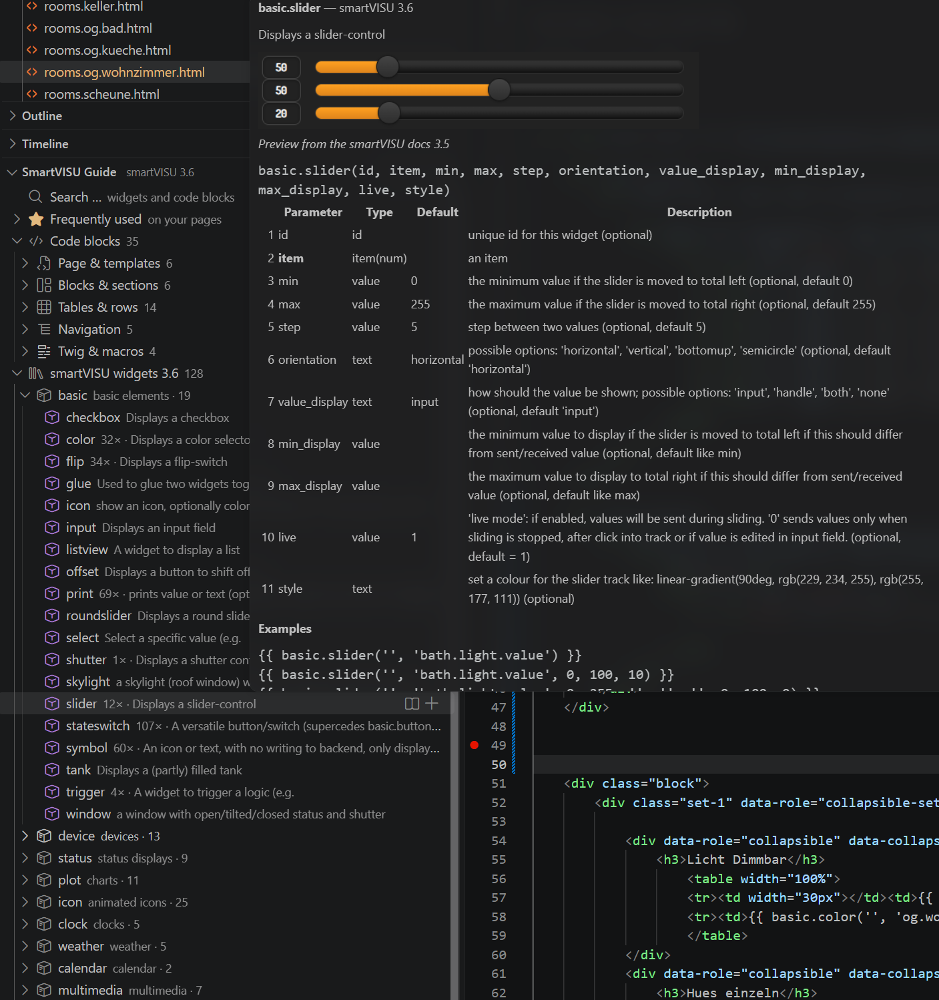

# smartVISU Assistant für VS Code

 [English](README.md)

*Inoffizielle Erweiterung – nicht vom smartVISU-Projekt.*

Schreibe [smartVISU](https://www.smartvisu.de)-Seiten schneller und mit weniger Fehlern:

- Alle Widgets deiner smartVISU-Version (2.9 bis 3.6) mit Parametern, Standardwerten und Beschreibung
- [SmartHomeNG](https://www.smarthomeng.de)-Items als Vorschläge – sortiert nach dem, was an der Stelle passt
- Seitenstruktur (Blöcke, Tabellenzeilen, Navigation, …) als Snippets
- Prüfung auf unbekannte oder entfernte Widgets, fehlende Items und doppelte IDs

## Der smartVISU-Guide

Im Explorer steht unter dem Verzeichnisbaum ein eigener Abschnitt **smartVISU-Guide**. Er zeigt alles, was sonst
Strg+Leertaste vorschlägt, zum Durchblättern – statt sich Widget-Namen merken zu müssen. Die Dateien bleiben daneben
sichtbar.



Was man im Bild sieht (die Beschriftungen sind englisch, weil VS Code dort englisch eingestellt ist – die Sprache folgt
der Einstellung `smartvisu.language`):

- **Links oben** die Dateien des Seitenordners, darunter der Guide. Seine Titelzeile zeigt die smartVISU-Version, für
  die er gerade gilt (hier 3.6, erkannt aus der Installation).
- **Suchen …** durchsucht Widgets und Code-Blöcke auf einmal und fügt die Auswahl ein.
- **Häufig verwendet**: deine meistgenutzten Widgets, gezählt auf deinen Seiten.
- **Code-Blöcke** nach Zweck, mit der Anzahl je Gruppe: Seite & Vorlagen, Blöcke & Abschnitte, Tabellen & Zeilen,
  Navigation, Twig & Makros.
- **smartVISU-Widgets 3.6** nach Paket (basic, device, status, plot, …). Jedes Widget zeigt seinen Namen, wie oft du es
  verwendest (z.B. `stateswitch 107×`), und den ersten Satz seiner Beschreibung.
- **Mit der Maus über einem Eintrag** – hier `slider` – erscheint die vollständige Hilfe: Vorschaubild aus der
  smartVISU-Doku, Aufruf mit allen Parametern, Tabelle mit Typ, Standardwert und Beschreibung (Pflichtparameter fett)
  und Beispiele. Bei Code-Blöcken zeigt das Bild, wie der Block mit Beispielinhalt aussieht, darunter steht der Code.
- **Am Ende des Eintrags** erscheinen zwei Knöpfe: Das **Buch** öffnet die Doku, **➕** fügt das Widget an der
  Cursorposition im Editor rechts ein – außerhalb von `{{ }}` mit Klammern, die Parameter als Platzhalter; bei einem
  Item-Parameter öffnet sich sofort die Item-Suche.

Außerdem:

- Ein Klick markiert einen Eintrag nur. **Enter** fügt den markierten Eintrag ebenfalls ein, mit gedrückter
  **Umschalttaste** kann man ihn an eine Stelle im Editor ziehen.
- **Eigene Widgets** stehen nach Datei geordnet darunter – auch aus Makrodateien, die die Seite noch nicht importiert;
  der `` wird beim Einfügen ergänzt.
- **Strg+Shift+Alt+G** springt in den Guide. Wie jeder Abschnitt lässt er sich verschieben, z.B. in die sekundäre
  Seitenleiste rechts.

## Funktionen

- **Widgets vorschlagen**: Beim Tippen (z.B. `dimmer`, `basic.`) oder mit **Strg+Leertaste** an jeder Stelle einer Seite
  erscheinen alle Widgets und Struktur-Snippets als Liste; jeder getippte Buchstabe kürzt die Liste (unscharfe Suche wie
  `bflip` → `basic.flip`), **Enter** fügt das Widget ein. Außerhalb von `{{ … }}` werden die Klammern mit eingefügt.
  Alternativ: **Strg+Shift+Alt+W** (*smartVISU: Widget einfügen …*) mit Beschreibung in der Schnellauswahl.
- **Items vorschlagen**: In einem Item-Parameter erscheinen die SmartHomeNG-Items – ebenfalls mit unscharfer Suche
  (`baddim` → `eg.bad.licht.spiegel.dimmen`) und Enter. Oben stehen Items, die
  - den vom Widget erwarteten Typ haben (`item(bool,num)` …),
  - zum Raum der Seite passen (`rooms.eg.bad.html` → `eg.bad.…`),
  - Geschwister der schon eingetragenen Items desselben Widgets sind (`…spiegel.schalten` → `…spiegel.dimmen`),
  - die Endung haben, die du bei diesem Widget sonst verwendest (`device.dimmer`: `…schalten` / `…dimmen`),
  - in der Nähe auf der Seite schon vorkommen.

  Items mit unpassendem Typ werden ausgeblendet (Einstellung `smartvisu.items.typeFilter`). **Strg+Shift+Alt+T** öffnet die Item-Suche als Schnellauswahl.
- **Hilfe für Felder, die von Hand befüllt werden**: Die Parameterhilfe zeigt beim Tippen in einem Widget nur den
  Parameter, der gerade dran ist – Zeile 1: Name und Pflicht/optional, Zeile 2: erlaubte Typen und Standardwert, darunter (falls sie etwas aussagen)
  Beschreibung, mögliche Werte und Bereich aus der smartVISU-Doku. Der Hover über einem ausgefüllten Parameter zeigt
  genau dasselbe. Dazu Vorschläge für
  - Wertelisten (`'mini'`, `'midi'`, `'icon'`, `'horizontal'`, …),
  - Werte, die du auf deinen Seiten für diesen Parameter schon verwendet hast (mit Häufigkeit),
  - Icons (aus `icons/ws` und `dropins/icons/ws` der Installation), Formate (`'°'`, `'%'`, `'kwh'`, …),
    Zeitdauern (`'1h'`, `'1d'`, …), Plot-Modi,
  - IDs – nach dem Item gebildet (`eg.bad.licht.decke.schalten` → `LichtDecke`) und eindeutig auf der Seite.
- **Eingefügte Widgets** bekommen die Pflichtparameter und so viele weitere, wie du bei diesem Widget sonst angibst,
  vorbelegt mit deinen üblichen Werten (Einstellung `smartvisu.insertParameters`). Der Cursor springt zuerst in das
  Item (Item-Suche öffnet sich sofort), mit **Tab** weiter zu den übrigen Parametern und zuletzt zur ID.
- **Struktur-Snippets** (`sv:…`): neue Seite, Vorlage mit Seitenleiste, Überschrift mit Icon, Block mit aufklappbarem
  Abschnitt, Block mit zwei Abschnitten, statischer Block, zwei Spalten, Tabelle, Zeilen „Bezeichnung | Widget“
  (Schalter, Wert, Status, Taster, Schieberegler, Zeitschaltuhr, Dimmer, Rollladen, RTR, Diagramm), Button-Gruppe,
  Navigationsliste/-eintrag/-wert, Reiterleiste, Kopfzeile, `import`/`extends`/`include`/`block`/`if`/`for`,
  eigenes Widget mit Docblock. Vorlagen, Kopfkommentar und einzubindende Dateien kommen aus deinem Seitenordner.
- **Weitere Vorschläge**: Icon-Namen nach `{{ icon0 }}`, Seiten in `index.php?page=`, Vorlagen und Makro-Dateien in
  ``, ``, ``.
- **Eigene Widgets**: Widgets aus `dropins/widgets`, `dropins/shwidgets`, `pages/<seiten>/widgets` und aus Dateien, die
  per `` eingebunden werden, werden wie die smartVISU-Widgets behandelt (Parameter aus
  dem Docblock, wie beim Widget-Assistenten von smartVISU).
- **Hilfe in der Vorschlagsliste**: **→** öffnet zum markierten Eintrag die vollständige Hilfe (Widget-Doku mit Vorschau,
  Parametern und Beispielen bzw. Item-Details), **↑/↓** blättern darin, **←** oder **Esc** schließt sie wieder. Mit der Maus:
  über den markierten Eintrag fahren und auf den kleinen Pfeil am Ende klicken. Abschaltbar mit `smartvisu.suggestDetailsKeys`.
- **Hover** über einem Widget (und Doku in der Vorschlagsliste): Vorschau, wie das Widget aussieht (Bild aus der
  smartVISU-Doku), Beschreibung, alle Parameter, Beispiele und Link zur Doku. **F12** springt zur Definition des Widgets.
- **Prüfungen**: entfernte Widgets (z.B. `basic.text` seit 3.0), unbekannte Widgets, zu viele Parameter, fehlende
  Pflichtparameter, Items, die es nicht gibt, Item-Typ passt nicht zum Widget, ungültige Werte aus Wertelisten,
  Werte außerhalb des Bereichs, doppelte IDs auf einer Seite, nicht gefundene Import-Dateien.
- **Einklappen**: Neben den HTML-Tags bekommen auch die Twig-Strukturen einen Pfeil am linken Rand: ``,
  `` (`` lässt sich getrennt einklappen), ``, ``, mehrzeilige `{# … #}`-Kommentare,
  der `/** … */`-Kopf, aufeinanderfolgende ``-Zeilen und Widget-Aufrufe über mehrere Zeilen. VS Code zeigt
  die Pfeile, sobald die Maus über dem Rand ist; mit `"editor.showFoldingControls": "always"` bleiben sie sichtbar.
  Tastenkürzel (deutsche Tastatur): **Strg+Shift+ß** klappt den Abschnitt am Cursor ein, **Strg+Shift+´** wieder aus,
  **Strg+K Strg+0** alles ein, **Strg+K Strg+J** alles aus, **Strg+K Strg+#** alle Kommentare ein. Welche Tasten bei
  deinem Layout gelten, zeigt *Datei → Einstellungen → Tastenkombinationen* (Suche „Fold“).
- **Statusleiste**: verwendete smartVISU-Version und Anzahl der Items; Klick wechselt die Version.

## Item-Quellen

| `smartvisu.items.source` | Items kommen aus |
|---|---|
| `auto` (Standard) | `smartvisu.items.path`, falls gesetzt, sonst der Erweiterung *SmartHomeNG Items*, sonst `masteritem.json` |
| `path` | dem SmartHomeNG-Verzeichnis in `smartvisu.items.path` – Items mit aufgelösten Structs, Name und Attributen |
| `shngItems` | der Erweiterung [SmartHomeNG Items](https://github.com/dasax/vscode-shng-items) (gleiches Verzeichnis `shngItems.basePath`, gleiches Item-Modell) |
| `masteritem` | `masteritem.json` im Seitenordner (schreibt das SmartHomeNG-Plugin *smartvisu*; nur Pfad und Typ) |
| `none` | keine Item-Vorschläge |

Änderungen an den Item-Dateien werden beim Speichern übernommen; sonst *smartVISU: Widgets und Items neu laden*.

## Einstellungen

| Einstellung | Bedeutung |
|---|---|
| `smartvisu.version` | `auto` (aus `version-info.php` der Installation), `installed` (Widgets direkt aus der Installation lesen) oder `3.6` … `2.9` |
| `smartvisu.installPath` | smartVISU-Installation, falls sie nicht oberhalb der geöffneten Seite liegt, z.B. `\\smarthomeng\smartvisu` |
| `smartvisu.items.source` | Quelle der Items (siehe oben) |
| `smartvisu.items.path` | SmartHomeNG-Verzeichnis, z.B. `\\smarthomeng\SmartHomeNG` |
| `smartvisu.items.typeFilter` | Item-Vorschläge nach Typ filtern: `learned` (Typen, die du bei diesem Widget-Parameter verwendest, z.B. `basic.flip` → nur `bool`; Standard), `widget` (Typen laut Widget-Beschreibung) oder `off` |
| `smartvisu.insertParameters` | `learned` (Pflicht + üblich), `required` oder `all` |
| `smartvisu.autoSuggest` | Vorschläge automatisch öffnen, wenn man mit Tab zu einem leeren Platzhalter springt |
| `smartvisu.diagnostics` | Prüfungen an/aus |
| `smartvisu.docuUrl` | Link zur Widget-Doku (Standard: docu.smartvisu.de) |
| `smartvisu.language` | Sprache: `auto`, `en`, `de` |

## Erkennung

Die Erweiterung arbeitet in HTML-/Twig-Dateien unter `pages/`, `dropins/` oder `widgets/` und in Dateien mit Twig
(`{{ … }}`, ``). Die smartVISU-Installation wird von der Datei aus nach oben gesucht (Ordner mit
`version-info.php`), der Seitenordner ist der Ordner direkt unter `pages/`. Aus allen Seiten dieses Ordners lernt die
Erweiterung, wie du Widgets verwendest.

## Entwicklung

```powershell
.\build.ps1 -Install    # baut die .vsix ohne Node.js und installiert sie lokal
```

Widget-Daten für die smartVISU-Versionen neu erzeugen (je Version ein schlanker Klon des Tags):

```bash
git clone --depth 1 --branch v3.6 --filter=blob:none --sparse https://github.com/Martin-Gleiss/smartvisu.git tags/v3.6
git -C tags/v3.6 sparse-checkout set widgets pages/docu
node tools/generate-widgets.js tags 3.6
```

Vorschaubilder neu erzeugen (erstes Beispiel jeder Widget-Seite von docu.smartvisu.de, mit Edge/Chrome im
Headless-Modus; vorhandene Bilder bleiben, außer mit `--force`):

```bash
node tools/generate-previews.js [--docu 3.5] [--force] [widget …]
# oder aus der Doku der eigenen Installation (läuft dort mit dem Offline-Treiber):
node tools/generate-previews.js --docu 3.6 --base "http://smarthomeng/smartvisu/index.php?pages=docu&page="
```

Vorschaubilder der Code-Blöcke neu erzeugen: Jeder Block wird mit Beispielinhalt als Seite in einem temporären
Seitenordner `pages/_svpreview` der eigenen Installation gerendert (Offline-Treiber, Design der Installation, `visu.css`
des mit `--style` genannten Seitenordners) und ausgeschnitten; der Ordner wird danach wieder gelöscht:

```bash
node tools/generate-block-previews.js --install //smarthomeng/smartvisu --url http://smarthomeng/smartvisu --style ksh [block …]
```

Tests ohne VS Code:

```bash
node test/smoke.js <seitenordner> [<smarthomeng-verzeichnis>]      # Parser, Lernen, Prüfungen, Snippets, Item-Reihenfolge
node test/features.js <seitenordner> [<smarthomeng-verzeichnis>]   # Vervollständigung, Parameterhilfe, Hover (nachgebildete API)
node test/folding.js [<seitenordner>]                              # Faltbereiche
```

`lib/shng/model.js` und `lib/shng/yaml.js` stammen aus der Erweiterung *SmartHomeNG Items* und sollten mit ihr abgeglichen werden.

## Lizenz

Copyright © 2026 dasax. Lizenz: GNU General Public License v3.0 oder später (`LICENSE`), wie smartVISU selbst. Das
Icon (smartVISU-Logo von Björn Bertschy), die Widget-Daten und die Vorschaubilder stammen aus
[smartVISU](https://github.com/Martin-Gleiss/smartvisu) – siehe `NOTICE.md`.
