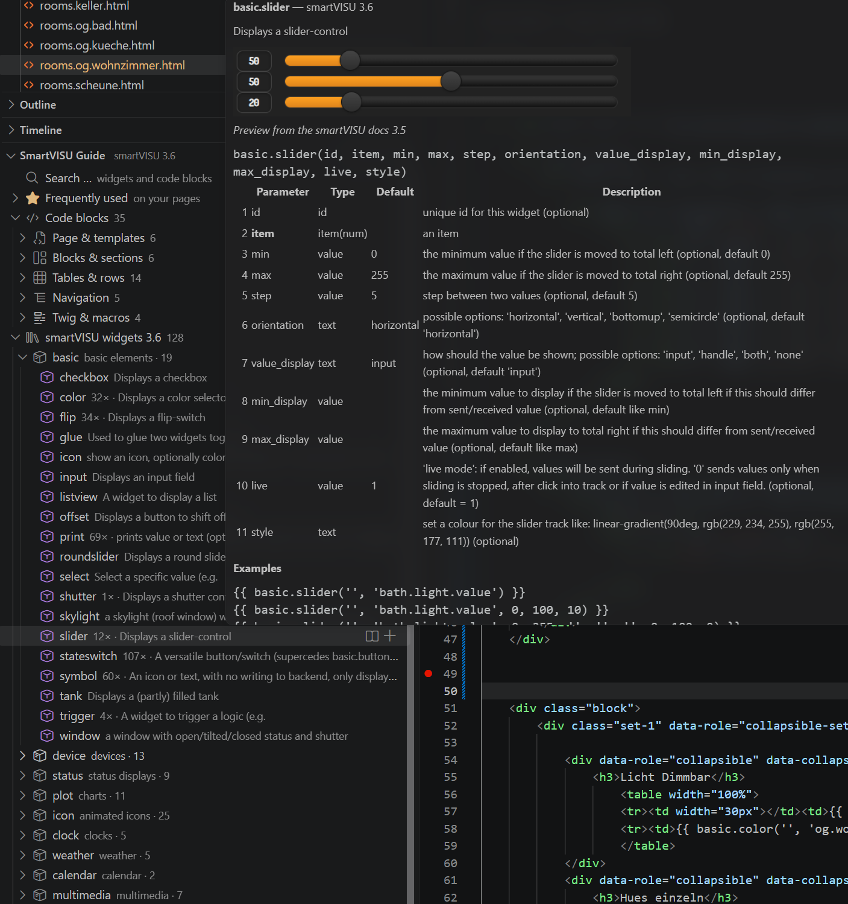
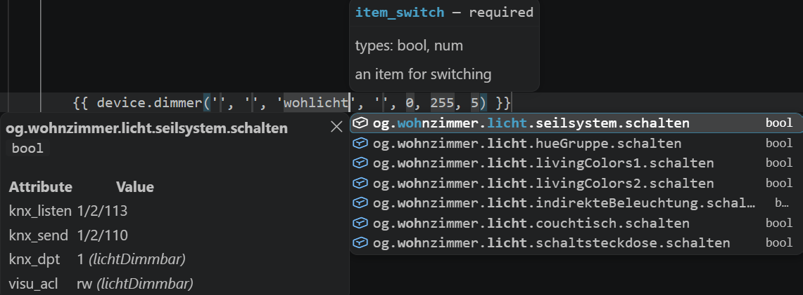

# smartVISU Toolkit for VS Code

 [Deutsch](README.de.md)

*Unofficial extension – not made or endorsed by the smartVISU project.*

Write [smartVISU](https://www.smartvisu.de) pages faster and with fewer mistakes:

- **Widgets and code blocks with previews**: all widgets of your smartVISU version (2.9 to 3.6) and ready-made page
  building blocks (blocks, table rows, navigation, …) laid out next to the folder tree – with a preview image, inserted
  into the page by drag & drop or with ➕
- **Autocompletion**: **Ctrl+Space** suggests the matching widgets in the editor, with help for every widget
- **Parameter help**: while filling in a widget, a short explanation of the parameter you are in
- **SmartHomeNG integration** (optional): matching items are suggested and can be searched

## The smartVISU guide

Below the folder tree in the Explorer there is a section **smartVISU Guide**. It shows everything Ctrl+Space would
suggest, to browse instead of having to remember widget names. Your files stay visible next to it.



What you see in the picture:

- **Top left** the files of the pages folder, below them the guide. Its title bar shows the smartVISU version it
  currently applies to (here 3.6, detected from the installation).
- **Search …** searches widgets and code blocks at once and inserts the selection.
- **Frequently used**: your most used widgets, counted on your pages.
- **Code blocks** by purpose, with the number per group: page & templates, blocks & sections, tables & rows,
  navigation, Twig & macros.
- **smartVISU widgets 3.6** by package (basic, device, status, plot, …). Each widget shows its name, how often you use
  it (e.g. `stateswitch 107×`) and the first sentence of its description.
- **Hovering over an entry** – here `slider` – shows the full help: preview image from the smartVISU docs, the call with
  all parameters, a table with type, default and description (required parameters in bold) and examples. For code
  blocks the picture shows how the block looks with sample content, followed by the code.
- **At the end of the entry** two buttons appear: the **book** opens the docs, **➕** inserts the widget at the cursor in
  the editor on the right – outside of `{{ }}` with braces, the parameters as placeholders; for an item parameter the
  item search opens right away.

Also:

- A click only selects an entry. **Enter** inserts the selected entry as well; holding **Shift** you can drag it to a
  place in the editor.
- **Custom widgets** are listed below by file – also from macro files the page does not import yet; the ``
  is added when inserting.
- **Ctrl+Shift+Alt+G** jumps into the guide. Like any view it can be moved, e.g. to the secondary side bar on the right.

## In the editor

While you write a page, the extension helps right in the code – with suggestions, help and checks.



What you see in the picture:

- `device.dimmer` is being filled in. The item parameter contains `wohlicht` – the fuzzy search finds
  `og.wohnzimmer.licht.…` with it, the matched letters are highlighted. The type of each item is shown on the right;
  only items whose type fits the parameter are offered.
- **At the top** the help for the parameter the cursor is in: `item_switch`, required, allowed types `bool, num` and
  the description from the smartVISU docs.
- **On the left** the details of the selected item (opened with **→**): type and attributes from SmartHomeNG, e.g. the
  KNX group addresses; in italics in brackets the struct an attribute comes from (here `lichtDimmbar`).

In detail:

- **Widget suggestions**: while typing (e.g. `dimmer`, `basic.`) or with **Ctrl+Space** anywhere on a page, all widgets
  and structure snippets appear as a list; every typed character narrows it down (fuzzy search like `bflip` →
  `basic.flip`), **Enter** inserts the widget. Outside of `{{ … }}` the braces are inserted as well.
  Alternatively **Ctrl+Shift+Alt+W** (*smartVISU: Insert widget …*) with descriptions in a quick pick.
- **Item suggestions**: in an item parameter the SmartHomeNG items appear – with fuzzy search as well
  (`baddim` → `eg.bad.licht.spiegel.dimmen`) and Enter. Items come first that
  - have the type the widget expects (`item(bool,num)` …),
  - match the room of the page (`rooms.eg.bad.html` → `eg.bad.…`),
  - are siblings of the items already entered in the same widget (`…mirror.switch` → `…mirror.dim`),
  - have the ending you usually use for this widget parameter,
  - already occur nearby on the page.

  Items with a non-matching type are hidden (setting `smartvisu.items.typeFilter`). **Ctrl+Shift+Alt+T** opens the item search as a quick pick.
- **Help for fields filled in by hand**: the parameter hints show only the parameter you are in –
  line 1: name and required/optional, line 2: allowed types and default, below it (if they say anything) the description, valid values and range from the
  smartVISU docs. Hovering over a filled-in parameter shows exactly the same. Plus suggestions for
  - value lists (`'mini'`, `'midi'`, `'icon'`, `'horizontal'`, …),
  - values you already used for this parameter on your pages (with counts),
  - icons (from `icons/ws` and `dropins/icons/ws` of the installation), formats (`'°'`, `'%'`, `'kwh'`, …),
    durations (`'1h'`, `'1d'`, …), plot modes,
  - IDs – derived from the item and unique on the page.
- **Inserted widgets** get the required parameters plus as many as you usually use for this widget, pre-filled with
  your usual values (setting `smartvisu.insertParameters`). The cursor starts in the item (the item search opens
  right away), **Tab** moves on to the other parameters and finally to the ID.
- **Structure snippets** (`sv:…`): new page, template with sidebar, heading with icon, block with collapsible section,
  block with two sections, static block, two columns, table, rows "label | widget" (switch, value, status, button,
  slider, timer, dimmer, shutter, thermostat, chart), button group, navigation list/entry/value, tab bar, header,
  `import`/`extends`/`include`/`block`/`if`/`for`, custom widget with docblock. Templates, header comment and files
  to include are taken from your pages folder.
- **More suggestions**: icon names after `{{ icon0 }}`, pages in `index.php?page=`, templates and macro files in
  ``, ``, ``.
- **Custom widgets** from `dropins/widgets`, `dropins/shwidgets`, `pages/<pages>/widgets` and from files imported with
  `` are handled like the smartVISU widgets (parameters from the docblock, as in the
  smartVISU widget assistant).
- **Help in the suggestion list**: **→** opens the full help of the selected entry (widget docs with preview, parameters
  and examples, or item details), **↑/↓** scroll it, **←** or **Esc** closes it again. With the mouse: hover over the selected
  entry and click the small arrow at its end. Can be turned off with `smartvisu.suggestDetailsKeys`.
- **Hover** on a widget (and docs in the suggestion list): preview of what the widget looks like (image from the
  smartVISU docs), description, all parameters, examples and a link to the docs. **F12** jumps to the widget definition.
- **Checks**: removed widgets (e.g. `basic.text` since 3.0), unknown widgets, too many parameters, missing required
  parameters, items that don't exist, item type not matching the widget, invalid values from value lists, values out
  of range, duplicate IDs on a page, import files not found.
- **Folding**: besides the HTML tags, the Twig structures get a fold arrow in the gutter on the left: ``,
  `` (`` folds separately), ``, ``, multi-line `{# … #}` comments, the
  `/** … */` header, consecutive `` lines and widget calls spread over several lines. VS Code shows the
  arrows when the mouse is over the gutter; with `"editor.showFoldingControls": "always"` they stay visible.
  Shortcuts (US layout): **Ctrl+Shift+[** folds the section at the cursor, **Ctrl+Shift+]** unfolds it, **Ctrl+K Ctrl+0**
  folds everything, **Ctrl+K Ctrl+J** unfolds everything, **Ctrl+K Ctrl+/** folds all comments. The keys for your
  layout are shown under *File → Preferences → Keyboard Shortcuts* (search "fold").
- **Status bar**: smartVISU version in use and number of items; click to switch the version.

## Item sources

| `smartvisu.items.source` | Items come from |
|---|---|
| `auto` (default) | `smartvisu.items.path` if set, otherwise the extension *SmartHomeNG Items*, otherwise `masteritem.json` |
| `path` | the SmartHomeNG directory in `smartvisu.items.path` – items with resolved structs, name and attributes |
| `shngItems` | the extension [SmartHomeNG Items](https://github.com/dasax/vscode-shng-items) (same directory `shngItems.basePath`, same item model) |
| `masteritem` | `masteritem.json` in the pages folder (written by the SmartHomeNG plugin *smartvisu*; path and type only) |
| `none` | no item suggestions |

Changes to the item files are picked up on save; otherwise use *smartVISU: Reload widgets and items*.

## Settings

| Setting | Meaning |
|---|---|
| `smartvisu.version` | `auto` (from `version-info.php` of the installation), `installed` (read widgets from the installation) or `3.6` … `2.9` |
| `smartvisu.installPath` | smartVISU installation if it is not above the opened page, e.g. `\\smarthomeng\smartvisu` |
| `smartvisu.items.source` | source of the items (see above) |
| `smartvisu.items.path` | SmartHomeNG directory, e.g. `\\smarthomeng\SmartHomeNG` |
| `smartvisu.items.typeFilter` | Filter item suggestions by type: `learned` (types you use for this widget parameter, e.g. `basic.flip` → only `bool`; default), `widget` (types from the widget description) or `off` |
| `smartvisu.insertParameters` | `learned` (required + usual), `required` or `all` |
| `smartvisu.autoSuggest` | open suggestions automatically when jumping to an empty placeholder with Tab |
| `smartvisu.diagnostics` | checks on/off |
| `smartvisu.url` | web address of the installation, e.g. `http://smarthomeng/smartvisu`; empty: derived from the network path (`\\server\smartvisu` → `http://server/smartvisu`) |
| `smartvisu.docuUrl` | link to the widget docs; empty (default): the docs that come with your installation (`…/index.php?pages=docu`) if reachable and matching the chosen version, otherwise docu.smartvisu.de |
| `smartvisu.language` | language: `auto`, `en`, `de` |

## Detection

The extension works in HTML/Twig files below `pages/`, `dropins/` or `widgets/` and in files containing Twig
(`{{ … }}`, ``). The smartVISU installation is searched upwards from the file (folder with `version-info.php`);
the pages folder is the folder directly below `pages/`. The extension learns from all pages in that folder how you
use the widgets.

## Development

```powershell
.\build.ps1 -Install    # builds the .vsix without Node.js and installs it locally
```

Regenerate the widget data of the smartVISU versions (one slim clone per tag):

```bash
git clone --depth 1 --branch v3.6 --filter=blob:none --sparse https://github.com/Martin-Gleiss/smartvisu.git tags/v3.6
git -C tags/v3.6 sparse-checkout set widgets pages/docu
node tools/generate-widgets.js tags 3.6
```

Regenerate the preview images (first example of every widget page on docu.smartvisu.de, with Edge/Chrome in
headless mode; existing images are kept unless `--force` is given):

```bash
node tools/generate-previews.js [--docu 3.5] [--force] [widget …]
# or from the docs of your own installation (they run with the offline driver there):
node tools/generate-previews.js --docu 3.6 --base "http://smarthomeng/smartvisu/index.php?pages=docu&page="
```

Regenerate the code block previews: every block is rendered with sample content as a page in a temporary pages
folder `pages/_svpreview` of your own installation (offline driver, design of the installation, `visu.css` of the
pages folder given with `--style`) and cut out; the folder is deleted afterwards:

```bash
node tools/generate-block-previews.js --install //smarthomeng/smartvisu --url http://smarthomeng/smartvisu --style ksh [block …]
```

Tests without VS Code:

```bash
node test/smoke.js <pages-folder> [<smarthomeng-dir>]      # parser, learning, checks, snippets, item order
node test/features.js <pages-folder> [<smarthomeng-dir>]   # completion, parameter hints, hover (mocked API)
node test/folding.js [<pages-folder>]                       # folding ranges
```

`lib/shng/model.js` and `lib/shng/yaml.js` come from the extension *SmartHomeNG Items* and should be kept in sync with it.

## License

Copyright © 2026 dasax. Licensed under the GNU General Public License v3.0 or later (`LICENSE`), like smartVISU
itself. The icon (smartVISU logo by Björn Bertschy), the widget data and the preview images come from
[smartVISU](https://github.com/Martin-Gleiss/smartvisu) – see `NOTICE.md`.
